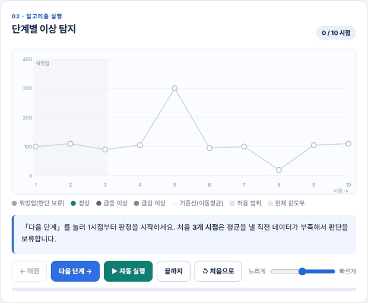
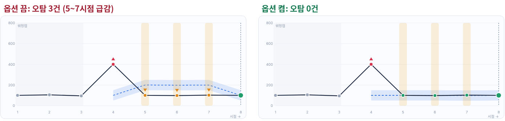

# Moving Average Anomaly Lab

> 명절 주문량 데이터에서 급증·급감을 찾아내는 **이동평균 기반 이상 탐지** 알고리즘을 단계별로 체험하는 웹 시뮬레이터

**▶ 시뮬레이터 바로 열기: https://<GitHub아이디>.github.io/moving-average-anomaly-lab/**



**English summary:** An interactive, single-file web simulator that teaches moving-average anomaly detection through a holiday order-monitoring scenario. Users can change the data, window size and threshold, step through each calculation, and compare how excluding detected anomalies from the baseline removes false alarms. Results were verified against hand calculations across four test cases. Built with HTML, CSS and vanilla JavaScript (no libraries), with generative AI (Claude) used for drafting and all logic verified manually.

---

## 프로젝트 소개
- **과목:** 문제해결형 프로그래밍 · 기말 산학연계 프로젝트 (Industry Algorithm Lab, 주제 15)
- **기간:** 2026.11 · **수행:** 개인 (김채현)
- **문제:** 명절 시즌 법인 주문 시스템에서 주문이 갑자기 폭주하거나(매크로 주문·트래픽 폭주) 끊기면(결제·서버 장애) 빨리 알아야 한다. 고정 기준("500건 이상이면 경보")은 주문 규모가 바뀌면 금방 쓸모가 없어진다.
- **해결:** 직전 N개 시점의 평균을 기준선으로 계속 갱신하고, 기준선에서 허용 범위보다 많이 벗어나면 이상으로 판정한다.
- **배경:** 명절 법인영업팀 주문 처리, 병원 검진 데이터 검증 알바에서 사람이 감으로 하던 "평소와 다르다" 판단을 수치 기준으로 자동화하는 원리를 구현했다.

## 주요 기능
| 기능 | 설명 |
|---|---|
| 입력·조건 변경 | 측정값(5~40개), 윈도우 N(2~10), 임계값 방식(고정/비율), 임계값, 이상값 제외 옵션, 시나리오(주문량/설비 온도) |
| 단계별 실행 | 이전/다음, 자동 실행, 속도 조절, 끝까지, 처음으로 + 단계마다 계산식 한 줄 설명 |
| 시각화 | 실제 값, 기준선(점선), 허용 범위 띠, 현재 윈도우 강조, 판정 색상(정상/급증/급감/워밍업) |
| 결과 | 판정 건수, 이상 시점별 원인 가능성 해석, 시점별 계산 표 |
| 예제 5종 | 기본, 기준선 오염 비교, 결제 장애, 설비 온도 센서, 한계: 서서히 증가 |
| 예외 처리 | 빈칸·문자·음수·범위 초과, N ≥ 데이터 개수 → 오류 메시지 + 실행 차단 |

## 사용 방법
1. 위 링크로 열거나 `index.html`을 더블클릭한다 (설치 불필요).
2. 「예제 불러오기」에서 예제를 고르거나 직접 값을 입력한다.
3. 「다음 단계」 또는 「자동 실행」으로 시점별 판정 과정을 확인한다.
4. 「이상값을 기준선에서 제외하기」를 켜고 끄며 결과를 비교한다.

## 알고리즘
```
각 시점 t에 대해:
  t ≤ N 이면: 판단 보류(워밍업)
  아니면:
    기준선 ← 직전 N개 값의 평균 (현재 값 제외, 옵션: 이상값은 건너뜀)
    허용 ← 고정값 또는 기준선 × p%
    편차 ← |x_t − 기준선|
    편차 > 허용 → 이상 (x_t > 기준선이면 급증, 아니면 급감), 같으면 정상
```
핵심 함수 `detectAnomalies()`는 화면 코드와 분리된 순수 함수이며 한국어 주석을 달았다.

## 테스트 결과
| # | 입력 | 확인 내용 | 결과 |
|---|---|---|---|
| 1 | 100,110,90,105,300,95,100,20,105,110 / N=3 / ±50 | 급증·급감 탐지, **손계산 비교** | ✅ 10개 시점 모두 일치 |
| 2 | 100,105,95,400,100,98,102,100 / N=3 / ±50 | 이상값 제외 옵션 효과 | ✅ 오탐 3건 → 0건 |
| 3 | 120,115,125,118,122,15,10,119,121,117 / N=4 / ±40% | 비율 방식, 다른 N | ✅ 일치 |
| 4 | 100,100,100,150,151 / N=3 / ±50 | 경계값(편차 = 허용 → 정상) | ✅ 일치 |

**확인한 한계:** 기준선 오염(이상값 하나가 이후 정상값을 오탐), 드리프트(100→188로 꾸준히 올라도 탐지 0건), 워밍업 구간, 계절성 미반영
자세한 내용: [docs/05_검증.md](docs/05_검증.md) · [보고서(PDF)](docs/보고서_공개용.pdf)



## 사용 기술
HTML · CSS · JavaScript (Vanilla, SVG 차트) · 외부 라이브러리 없음 · 단일 파일

## 생성형 AI 활용
| 직접 한 일 | AI(Claude)를 활용한 일 |
|---|---|
| 주제 선정, 판정 규칙 확정(직전 N개 평균, 경계값, 워밍업, 오염 방지 옵션) | 산업 사례 자료 탐색 |
| 손계산 검증, AI 결과물 오류 발견·수정 | 화면 설계안, 코드 초안 작성 |
| 보고서 검토, 최종 판단 | 테스트 자동화, 보고서 초안 |

AI가 쓴 "결제 장애" 예제 설명이 손계산 결과(8~10시점 급증)와 달라 수정했다.

## 참고자료
1. AWS, [Using CloudWatch anomaly detection](https://docs.aws.amazon.com/AmazonCloudWatch/latest/monitoring/CloudWatch_Anomaly_Detection.html)
2. AWS Cloud Operations Blog, [How to set up CloudWatch Anomaly Detection to set dynamic alarms, automate actions, and drive online sales](https://aws.amazon.com/blogs/mt/how-to-set-up-cloudwatch-anomaly-detection-to-set-dynamic-alarms-automate-actions-and-drive-online-sales)
3. Datadog, [Anomaly Monitor](https://docs.datadoghq.com/monitors/types/anomaly/)

※ 실제 서비스는 추세·계절성을 반영한 통계·머신러닝 모델을 사용한다. 이 시뮬레이터는 그 핵심 아이디어를 단순화한 교육용이다.

## 폴더 구조
```
moving-average-anomaly-lab/
├─ index.html            시뮬레이터
├─ README.md
├─ screenshots/          실행 화면, 테스트 결과, 손계산 노트
└─ docs/
   ├─ 보고서_공개용.pdf
   ├─ 01_진행현황.md · 02_조사메모.md · 03_설계.md · 05_검증.md · 05_손계산_답지.md
   └─ report_assets/
```
